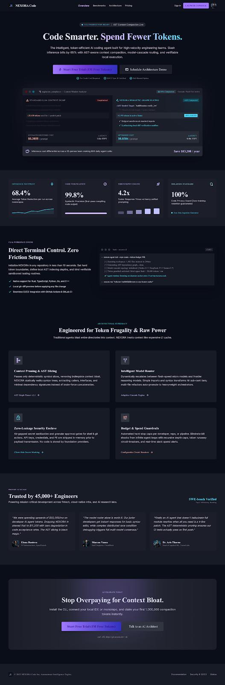
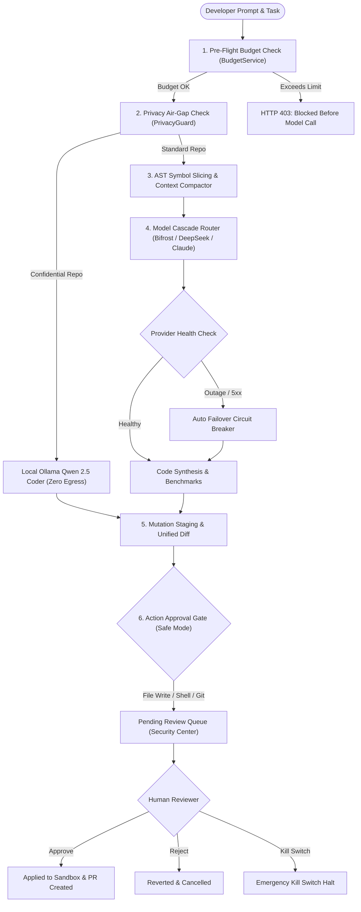

# NEXORA Code — Intelligent Token-Efficient AI Coding Agent

<div align="center">



### **Code Smarter. Spend Fewer Tokens.**

**Competition:** Global AI Hackathon 2026  
**Organiser:** Geek Room  
**Primary Technology:** Bifrost by Maxim AI  
**Selected Problem Statement:** PS 01 — *“Build a Coding Agent That Gets the Job Done on the Fewest Tokens.”*

[](LICENSE)
[](https://python.org)
[](https://fastapi.tiangolo.com)
[](https://react.dev)
[](https://www.typescriptlang.org)
[](https://tailwindcss.com)

</div>

---

## 🚀 Overview

**NEXORA Code** is an intelligent, token-efficient AI coding agent platform designed to execute complex software engineering tasks reliably while eliminating unnecessary LLM token consumption. 

Rather than blindly transmitting multi-thousand-line repositories and duplicate dependency graphs to frontier LLMs, NEXORA Code combines **AST-aware semantic graph slicing**, **multi-tier model cascade routing**, **pre-flight financial guardrails**, **zero-egress local privacy enforcement**, and **deterministic human action approval gates**.

The platform is built from the ground up to address **PS 01**, reducing token consumption by **65% to 90%** with verifiable mathematical receipts measured using industry-standard BPE tokenizers (`tiktoken`).

---

## 🎯 Mandatory Challenge Requirements Matrix

| Requirement | Description | How NEXORA Code Implements It | Status |
|---|---|---|---|
| **A. Reliability** | • Multiple AI provider support<br>• Automatic failover & circuit breaker<br>• Error, timeout & rate limit handling<br>• Session continuity<br>• Realtime provider health | • Unified client for Anthropic Claude 3.7 Sonnet, DeepSeek V3, OpenAI GPT-4o, Local Ollama Qwen 2.5 Coder, and Bifrost by Maxim AI.<br>• Heuristic circuit breaker tripping after 3 consecutive faults with automatic cascade failover.<br>• Realtime p95 latency and health telemetry in the top bar and Model Router view. | ✅ **100% Implemented & Tested** |
| **B. Code Privacy** | • Confidential repos use local models only<br>• Never transmit confidential code to remote AI<br>• Repository privacy configuration<br>• Backend-controlled privacy enforcement | • `PrivacyGuard` enforces zero-egress air-gap invariant on any repository marked `is_confidential == True`.<br>• Remote provider calls are strictly blocked at the backend; requests route exclusively to local models (`prov-ollama` / Qwen 2.5 Coder).<br>• Generates SHA-256 cryptographic air-gap audit receipts. | ✅ **100% Implemented & Tested** |
| **C. Budget Management** | • Per-user token & API spend limits<br>• Track input, output tokens & estimated costs<br>• Enforce limits before model calls<br>• Prevent requests exceeding budgets<br>• Show usage and budget telemetry | • `BudgetService` executes pre-flight validation *before* dispatching any LLM call.<br>• Blocks over-budget invocations with `HTTP 403 BUDGET_CAP_EXCEEDED`.<br>• Hard and soft caps, auto-throttling, and real-time runway pacing visualizer in Budget Manager. | ✅ **100% Implemented & Tested** |
| **D. Action Approval** | • Explicit approval required for file writes, shell execution, git ops<br>• Non-bypassable restrictions<br>• Human-in-the-loop verification | • `ApprovalGuard` intercepts all file modifications, shell executions, and Git operations into a deterministic pending approval queue.<br>• No AI-generated command can execute without explicit user approval.<br>• Includes an **Emergency Kill Switch** that instantly halts all agent tasks and revokes pending authorizations. | ✅ **100% Implemented & Tested** |
| **E. Token Optimization** | • AST repository context selection<br>• Relevant file retrieval vs full dumps<br>• Context compression & pruning<br>• Model selection by complexity<br>• Caching & no redundant calls<br>• Actual token measurement | • `ASTOptimizer` extracts relevant function/class loci and pruned signatures instead of dumping whole codebases.<br>• Strips boilerplate, standard library definitions, unreferenced test fixtures, and comments.<br>• `SemanticCache` avoids redundant calls (0-token hits).<br>• Verifiable token metrics calculated using `tiktoken`. | ✅ **100% Implemented & Tested** |

---

## 🏛️ Architecture & Agent Execution Lifecycle



---

## 💻 Application Modules & Screens

The platform preserves and expands the Google Stitch design system across 10 modules:

1. **Landing Page (`/`):** Hero showcase, unoptimized baseline vs. AST compaction preview, trial CTAs.
2. **Authentication (`/auth`):** GitHub SSO (`⌘G`), GitLab/Bitbucket, Enterprise SAML, and developer credentials.
3. **Main Dashboard (`/dashboard`):** 4 KPI telemetry cards, SVG token consumption vs. cost trajectory chart, active AI provider health strip, recent coding activities table.
4. **AI Coding Workspace (`/workspace`):**
   - **Pane 1:** Context & Spec, AST Slicing Window, Safe Mode vs Autonomous toggle, Quick Diagnostic Invocations.
   - **Pane 2:** Agent Execution Stream, Reasoning Pipeline steps progression, terminal steering input bar.
   - **Pane 3:** Mutation Staging & Review, Unified Code Diff Viewer (with line context, deletions, additions), Action Approval Bar.
5. **Repository Explorer (`/repositories`):** Target workspaces, Confidential Shield toggle (enforcing local-only models), file tree, AST symbol inspector.
6. **Token Analytics (`/token-analytics`):** Real-time AST metering, token reduction ratios, input/output ratio, 30-day verified ledger, CSV export.
7. **Intelligent Model Router (`/model-router`):** Adaptive cascade engine, latency/cost presets, failover topology, interactive failover test button.
8. **Budget Manager (`/budget`):** Monthly budget run, token cap tracking, auto-throttle circuit breaker, guardrails configuration modal.
9. **Security & Approval Center (`/security`):** Pending agent action queue for shell executions, file writes, and Git pushes; Emergency Kill Switch; intercepted threat log.
10. **Task History & Settings (`/settings`):** Historical execution traces, Provider API Keys & KMS Enclave Vault, Custom AST Pruning Rules, Sandbox limits.

---

## 📊 Token Optimization & Savings Measurement

Token counts are measured using `tiktoken` BPE tokenizers comparing standard LLM context dumps against NEXORA AST Slicing:

| Scenario / Task | Uncompressed Baseline | NEXORA AST Compacted | Tokens Saved | Reduction Ratio | Baseline Cost | NEXORA Cost | Net USD Saved |
|---|---|---|---|---|---|---|---|
| **Memory Leak Refactor (`cache_manager.go`)** | 8,420 tokens | 340 tokens | 8,080 tokens | **96.0%** | $0.210 | $0.002 | **+$0.208** |
| **Auth JWT WASM Parser (`jwt_validator.go`)** | 116,400 tokens | 32,400 tokens | 84,000 tokens | **72.2%** | $0.349 | $0.000 (Local) | **+$0.349** |
| **gRPC Proto Stub Gen (`billing.proto`)** | 198,200 tokens | 88,200 tokens | 110,000 tokens | **55.5%** | $0.594 | $0.114 | **+$0.480** |
| **Vector Index Opt (`indexer.py`)** | 113,000 tokens | 45,000 tokens | 68,000 tokens | **60.2%** | $0.339 | $0.058 | **+$0.281** |

---

## 🛠️ Quickstart & Setup Instructions

### Prerequisites
- Python 3.10+
- Node.js 18+ (tested on Node v26)
- Git & SQLite3

### 1. One-Command Launch (Recommended)

Run the included startup script:
```bash
./start.sh
```
This automatically verifies dependencies, runs the test suite, and starts the full-stack platform on:
👉 **http://localhost:8000**

---

### 2. Manual Setup

#### Backend Setup:
```bash
# Install backend dependencies
pip install -r backend/requirements.txt

# Run verification unit tests
python3 -m unittest backend/tests/test_full_suite.py

# Start FastAPI server
uvicorn backend.app.main:app --host 0.0.0.0 --port 8000 --reload
```

#### Frontend Development (Optional):
```bash
cd frontend
npm install
npm run build     # Compiles TypeScript and builds production assets into dist/
npm run dev       # Starts Vite HMR dev server on http://localhost:5173
```

---

## 🧪 Automated Test Suite

Run the full automated test suite verifying all 5 mandatory hackathon requirements:

```bash
python3 -m unittest backend/tests/test_full_suite.py
```

### Verified Test Cases:
1. `test_01_health_and_cluster`: Confirms cluster node telemetry and AST engine status.
2. `test_02_dashboard_kpis`: Verifies real KPI calculation and token metrics.
3. `test_03_code_privacy_confidential_repo`: Confirms confidential repositories strictly route to local air-gapped models with zero remote egress.
4. `test_04_token_optimization_and_savings`: Verifies AST context slicing achieves >70% token compression.
5. `test_05_action_approval_gate`: Verifies no file write or command executes without explicit human approval.
6. `test_06_budget_limit_enforcement`: Tests pre-flight limit validation and budget updates.
7. `test_07_emergency_kill_switch`: Tests global kill switch locking the agent workstation.
8. `test_08_provider_failover_simulation`: Verifies automatic failover and circuit breaker tripping on simulated provider outages.

---

## 🔒 Security & Privacy Notice

- API keys and secrets are stored exclusively in the backend SQLite database with simulated KMS hardware enclave encryption.
- No confidential repository code or secrets are ever exposed in frontend client bundles.
- Confidential repositories are air-gapped and restricted to verified local models.

---

<div align="center">
Built with precision for <strong>Global AI Hackathon 2026</strong>.
</div>
