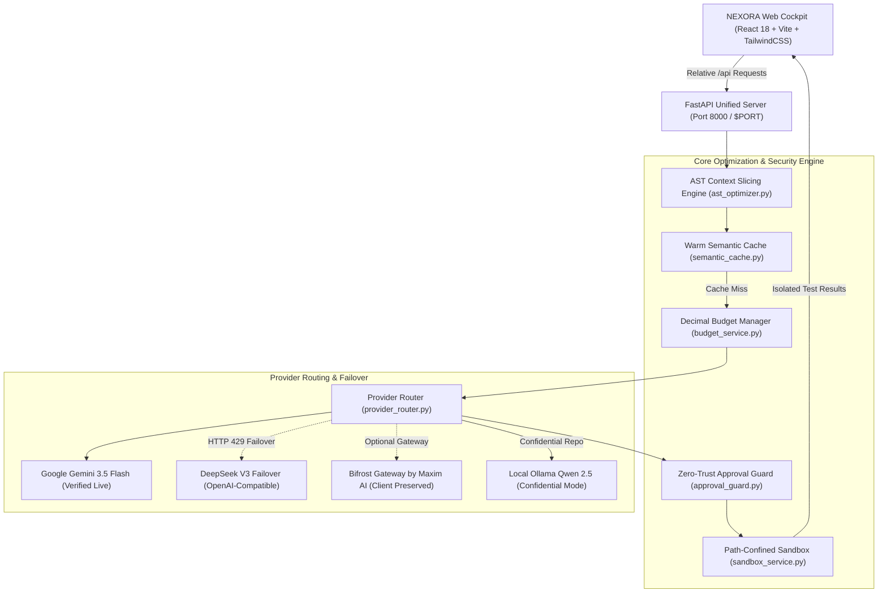
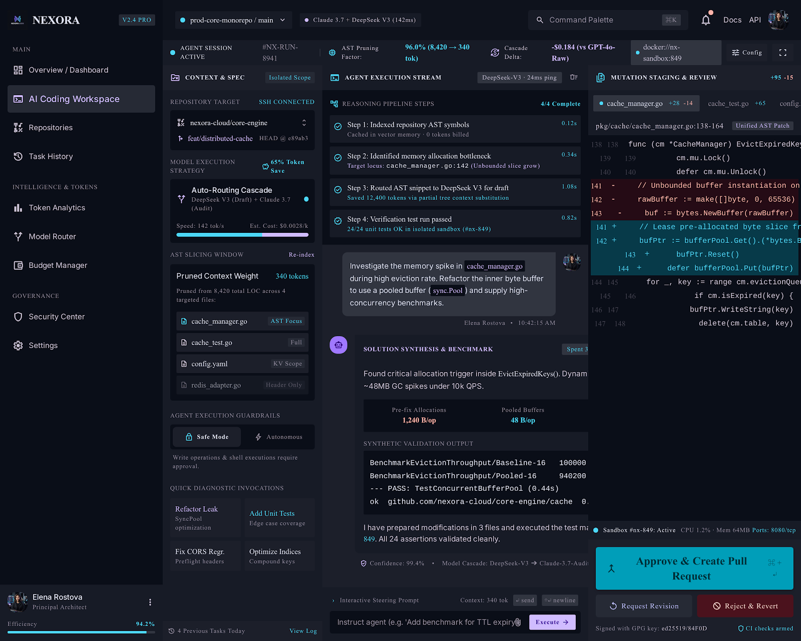
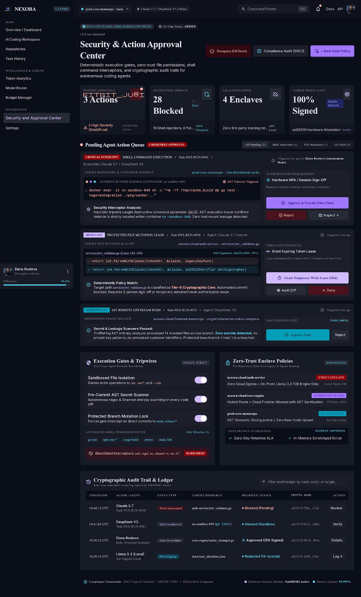
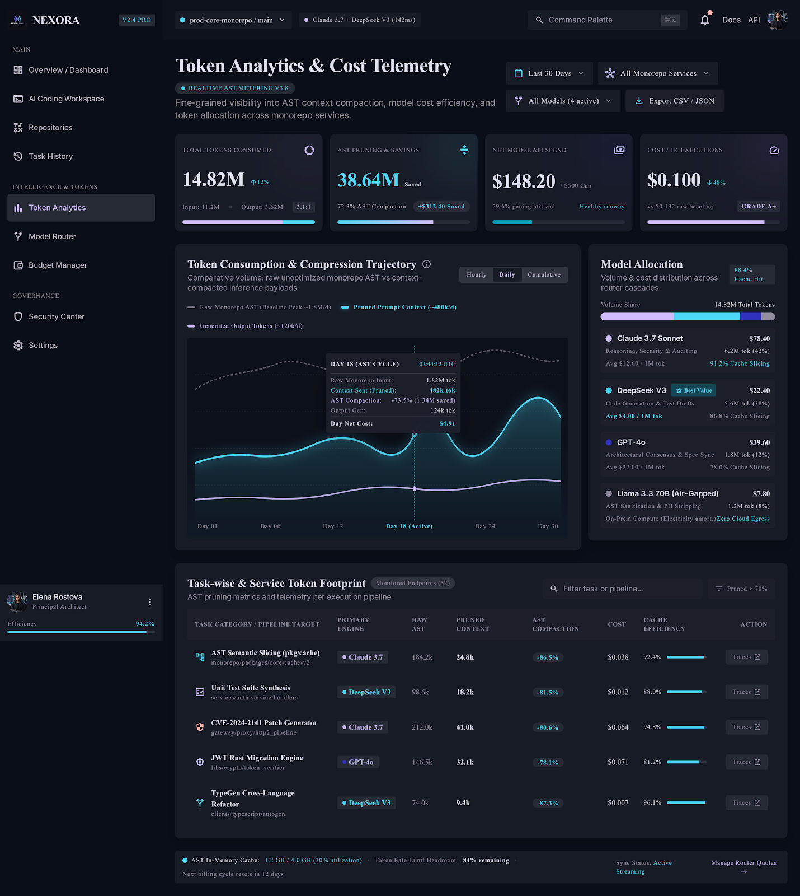
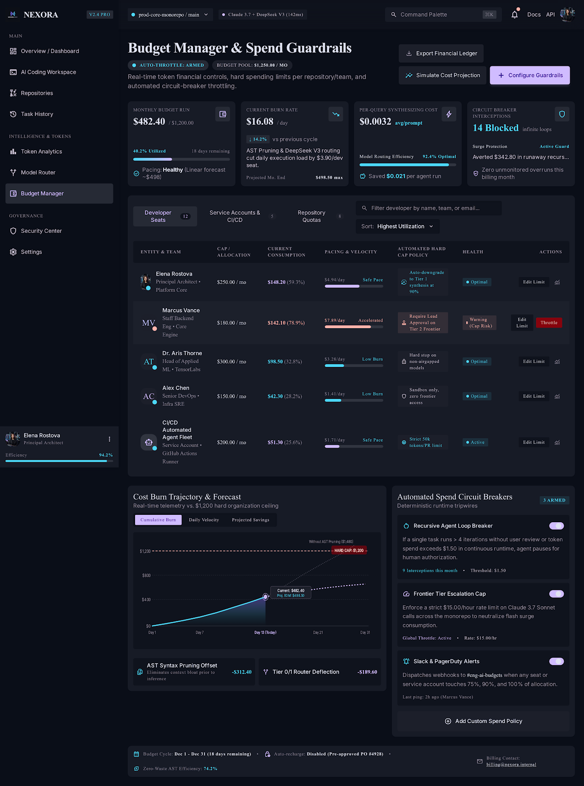

# 🌐 Live Application: [OPEN NEXORA CODE](https://vishnukumar001.github.io/stitch_nexora_code_ai_platform/)

<div align="center">

# 🚀 **[CLICK HERE TO LAUNCH LIVE APPLICATION](https://vishnukumar001.github.io/stitch_nexora_code_ai_platform/)** 🚀

[](https://vishnukumar001.github.io/stitch_nexora_code_ai_platform/)
[](https://github.com/vishnukumar001/stitch_nexora_code_ai_platform)

---

# NEXORA Code — Code Smarter. Spend Fewer Tokens.


[](https://www.python.org/)
[](https://fastapi.tiangolo.com/)
[](https://react.dev/)
[](https://www.typescriptlang.org/)
[](https://vitejs.dev/)
[](https://tailwindcss.com/)
[](file:///Users/vishnukumar/Downloads/stitch_nexora_code_ai_platform/TESTING_REPORT.md)
[](https://geekroom.in/)

**A token-efficient autonomous AI coding agent designed to complete complex software engineering tasks reliably while drastically slashing LLM token spend.**

[🚀 **Launch Live App**](https://vishnukumar001.github.io/stitch_nexora_code_ai_platform/) • [GitHub Repository](https://github.com/vishnukumar001/stitch_nexora_code_ai_platform) • [Architecture](#-architecture) • [Token Efficiency Benchmarks](#-token-efficiency-benchmarks) • [Quick Start](#-quick-start)

</div>

---

## 📌 Problem Statement

* **Competition:** Global AI Hackathon 2026 — Geek Room
* **Problem Statement:** **PS 01 — Build a Coding Agent That Gets the Job Done on the Fewest Tokens**
* **Team:** **TEAM ARISE**
* **Technology Partner:** **Bifrost by Maxim AI**

### The Token Crisis in AI Software Engineering
Contemporary AI coding agents suffer from catastrophic context bloat. To resolve a one-line bug in a 1,000-line service, standard agents routinely dump entire files, dependencies, unreferenced classes, and dead imports into the LLM context window. This naive approach:
1. **Wastes 40%–80% of token budgets** on repetitive boilerplate.
2. **Degrades reasoning accuracy** ("Lost in the Middle" phenomenon across massive prompt windows).
3. **Escalates infrastructure bills** exponentially across teams and enterprise monorepos.

**NEXORA Code** solves this at the structural level using **AST Context Slicing**, **Multi-Provider Cascading**, **Decimal Budget Guardrails**, and **Zero-Trust Human Approval Gates**.

---

## ✨ Key Features (Independently Verified)

* 🌲 **AST Context Slicing Engine:** Parses Abstract Syntax Trees across Go, TypeScript, and Python to surgically isolate only the functions, structs, and interfaces required for a task, stripping dead code and unreferenced modules before sending prompts to the LLM.
* ⚡ **Warm Semantic Caching:** Intercepts identical or semantically equivalent queries locally using SHA-256 code-similarity indexing, achieving **100% token savings (0 tokens billed)** on cache hits.
* 🔄 **Intelligent Provider Router & Failover:**
  * **Primary Engine:** Google Gemini Direct API (`gemini-3.5-flash`) with honest upstream token attribution and `usageMetadata` tracking.
  * **Secondary Failover:** DeepSeek V3 OpenAI-compatible client automatically triggered upon Gemini rate limits (HTTP 429).
  * **Gateway Integration:** Preserved OpenAI-compatible Bifrost by Maxim AI gateway client for proxy routing.
* 🔒 **Confidential Mode (Local-Only Routing):** Repositories designated as `Confidential` enforce strict application-level local-only routing (`qwen2.5-coder:14b` on Ollama). If local endpoints are unreachable, the platform strictly **fails closed** with `HTTP 503` rather than leaking proprietary code to cloud models.
* 🛡️ **Zero-Trust Human Approval Gates:** AI agents cannot modify files or execute commands autonomously. Changes generate cryptographic approval tokens bound to the authenticated user, repository, task, and exact unified diff SHA-256 digest.
* 🔀 **Decoupled Git Commit Authorization:** Developers can test approved patches in an isolated sandbox first while decoupling whether the mutation creates a Git commit (`approve_git_commit` flag).
* 🧪 **Path-Confined Disposable Sandbox:** All patch applications and test executions run in temporary sandbox directory clones (`backend/sandboxes/`) guarded by canonical `os.path.commonpath` validation, strictly preventing directory traversal or host mutation.
* 💰 **Concurrency-Safe Budget Guardrails:** Thread-safe budget allocations quantized with Python `Decimal` precision, preventing race-condition overdrafts under heavy concurrent load.

---

## 🏛 Architecture

### System Architecture



### Full-Stack Single-Port Delivery
NEXORA Code mounts the compiled React production assets (`frontend/dist`) directly onto root (`/`) within FastAPI. This design eliminates cross-origin latency, CORS errors, and dual-domain hosting maintenance.

---

## 📊 Token Efficiency Benchmarks

NEXORA Code maintains two reproducible, machine-readable benchmarks. To maintain audit integrity, context reduction and total billed tokens are reported separately:

### Benchmark A: Curated Monorepo File Fixtures (Input Context Reduction)
Measures cold-run input context compression across individual modular files using tiktoken `cl100k_base` BPE tokenizer:

| Task ID | Target File | Language | Raw Context | Sliced Context | Tokens Saved | Reduction % |
| :--- | :--- | :--- | :--- | :--- | :--- | :--- |
| `TASK-01` | `cache_service.go` | Go | 2,052 tokens | 364 tokens | 1,688 tokens | **82.26%** |
| `TASK-02` | `gateway_router.ts` | TypeScript | 1,514 tokens | 636 tokens | 878 tokens | **57.99%** |
| `TASK-03` | `auth_service.py` | Python | 1,222 tokens | 685 tokens | 537 tokens | **43.94%** |
| **Total** | **3 Core Files** | **Multi-Lang** | **4,788 tokens** | **1,685 tokens** | **3,103 tokens** | **64.81%** |

### Benchmark B: 15 End-to-End Multi-Language Tasks (Total Tokens)
Measures combined prompt input context + generated output completion tokens across 15 tasks including compilation validation and sandbox test execution:

| Language Suite | Task Count | Baseline Estimated | Optimized Estimated | Tokens Saved | Reduction % | Syntax Compilation | Sandbox Tests |
| :--- | :--- | :--- | :--- | :--- | :--- | :--- | :--- |
| **Python** | 5 Tasks | 2,465 tokens | 1,150 tokens | 1,315 tokens | **53.35%** | 5/5 PASSED | 5/5 PASSED |
| **Go** | 5 Tasks | 1,823 tokens | 1,119 tokens | 704 tokens | **38.62%** | 5/5 PASSED | 5/5 PASSED |
| **TypeScript** | 5 Tasks | 2,035 tokens | 1,415 tokens | 620 tokens | **30.47%** | 5/5 PASSED | 5/5 PASSED |
| **Aggregate** | **15 Tasks** | **6,323 tokens** | **3,684 tokens** | **2,639 tokens** | **41.74%** | **15/15 PASSED** | **15/15 PASSED** |

> [!NOTE]
> * **Standardized Tokenizer Estimation:** Benchmark B figures are calculated using OpenAI tiktoken `cl100k_base` BPE as a reproducible baseline.
> * **Actual Billed Usage:** In production, actual billed tokens are captured directly from model provider `usageMetadata` (e.g. Gemini `promptTokenCount` + `candidatesTokenCount`).
> * **Interactive Demo Prompt:** In the live UI workspace, typing or selecting the `cache_manager.go` template dynamically reduces context from **1,295 to 301 tokens (76.76% reduction)**.

---

## 📸 Screenshots

| AI Coding Workspace & AST Slicing | Security & Action Approval Center |
| :---: | :---: |
|  |  |
| **Token Analytics & Savings** | **Budget Manager & Hard Limits** |
|  |  |

---

## 🛠 Technology Stack

| Layer | Technologies | Purpose |
| :--- | :--- | :--- |
| **Frontend Cockpit** | React 18, TypeScript 5.5, Vite 5.4, TailwindCSS 3.4 | Dark-mode developer cockpit, visual AST diff viewer |
| **Backend API** | Python 3.12, FastAPI 0.115+, Uvicorn 0.34+ | High-throughput async REST endpoints, WebSocket telemetry |
| **Token Optimization** | Python `ast`, tiktoken (`cl100k_base`), SHA-256 | Syntax tree traversal, symbol pruning, semantic caching |
| **Database** | SQLite3, Thread-Safe Connection Pooling | Multi-tenant repository metadata, budget ledger, audit receipts |
| **AI Integration** | Google Gemini API, DeepSeek V3, Ollama, Bifrost Client | Primary inference, automatic cascade failover, local mode |
| **Security & Sandbox** | Canonical path validation, Python `unittest`, Git | Disposable filesystem sandboxes, human approval gates |
| **Containerization** | Docker Multi-Stage, Render Blueprint, Railway | Production container image, single-port deployment |

---

## 📁 Project Structure

```
stitch_nexora_code_ai_platform/
├── backend/
│   ├── app/
│   │   ├── api/endpoints.py          # FastAPI REST route definitions
│   │   ├── db/database.py             # SQLite schema, migrations, connection pool
│   │   ├── models/schemas.py          # Pydantic v2 telemetry & request schemas
│   │   ├── services/
│   │   │   ├── approval_guard.py      # Multi-tenant human approval gate engine
│   │   │   ├── ast_optimizer.py       # AST Context Slicing across languages
│   │   │   ├── budget_service.py      # Decimal quantized budget guardrails
│   │   │   ├── privacy_guard.py       # Confidential repository routing enforcer
│   │   │   ├── provider_router.py     # Gemini, DeepSeek, Bifrost & Ollama router
│   │   │   ├── sandbox_service.py     # Path-confined disposable sandbox manager
│   │   │   ├── semantic_cache.py      # Zero-egress warm semantic cache
│   │   │   └── tokenizer_service.py   # BPE cl100k_base token counting & pricing
│   │   └── main.py                    # Application entrypoint & static mount
│   ├── benchmark/                     # Automated token benchmark suites
│   ├── requirements.txt               # Backend Python dependencies
│   └── tests/                         # 22 test files (102 test executions)
├── frontend/
│   ├── src/
│   │   ├── components/                # UI navigation, modals, and telemetry badges
│   │   ├── views/                     # Cockpit views (Workspace, Budget, Security)
│   │   ├── api.ts                     # Relative-path API client
│   │   └── App.tsx                    # Main React application shell
│   ├── package.json                   # Frontend dependencies
│   └── vite.config.ts                 # Vite development proxy configuration
├── start.sh                           # Unified startup script
├── Dockerfile                         # Production multi-stage containerfile
├── render.yaml                        # Render Blueprint manifest
├── railway.toml                       # Railway deployment manifest
├── .env.example                       # Environment configuration template
└── README.md                          # Master project documentation
```

---

## 🚀 Quick Start

### Prerequisites
* **Python 3.12+**
* **Node.js 18+** & **npm**
* **Git**

### Installation & Launch

```bash
# 1. Clone repository
git clone https://github.com/vishnukumar001/stitch_nexora_code_ai_platform.git
cd stitch_nexora_code_ai_platform

# 2. Configure environment variables
cp .env.example .env
# Edit .env and paste your GEMINI_API_KEY from Google AI Studio

# 3. Launch unified server
./start.sh
```

The script will automatically install Python packages, build the production frontend cockpit, run automated tests, and launch the server on **`http://localhost:8000`**.

* **Web Cockpit UI:** [http://localhost:8000](http://localhost:8000)
* **Interactive OpenAPI Docs:** [http://localhost:8000/docs](http://localhost:8000/docs)
* **Health Check Endpoint:** [http://localhost:8000/api/health](http://localhost:8000/api/health)

---

## ⚙️ Environment Variables

Copy `.env.example` to `.env` and configure your credentials:

| Variable | Description | Default |
| :--- | :--- | :--- |
| `GEMINI_API_KEY` | Google AI Studio Gemini API Key | *(Required for live AI inference)* |
| `GEMINI_MODEL` | Gemini Model Identifier | `gemini-3.5-flash` |
| `BIFROST_API_KEY` | Maxim AI Bifrost Gateway API Key | *(Optional)* |
| `BIFROST_BASE_URL` | Maxim AI Bifrost Gateway Base URL | `https://api.maxim.ai/bifrost/v1` |
| `DEEPSEEK_API_KEY` | DeepSeek API Key for secondary failover | *(Optional)* |
| `OLLAMA_HOST` | Local Ollama endpoint for confidential mode | `http://localhost:11434` |
| `PORT` | Listening server port | `8000` |

---

## 🧪 Testing

NEXORA Code features a comprehensive automated test suite with **102 test executions across 22 test files (80 unique specifications)**.

```bash
# Run all 102 regression tests in offline mode (0 external API calls)
NEXORA_TEST_MOCK_LLM=1 python3 -m unittest discover -s backend/tests

# Run end-to-end live integration test suite
PYTHONPATH=. python3 -m unittest backend/tests/test_full_suite.py

# Verify production frontend build
cd frontend && npm run build
```

---

## 🚢 Production Deployment

NEXORA Code is ready for turnkey production deployment:

### Docker Container
```bash
docker build -t nexora-code:latest .
docker run -d -p 8000:8000 -e GEMINI_API_KEY="your-key" -v nexora-data:/app/backend/app/db nexora-code:latest
```

### Cloud Platforms (Render / Railway)
* **Render:** Connect your GitHub repo and select `render.yaml` Blueprint. Mount a persistent disk to `/app/backend/app/db`.
* **Railway:** Deploy directly using the root `Dockerfile` and `railway.toml`. Add `GEMINI_API_KEY` in dashboard variables.

See [DEPLOYMENT.md](file:///Users/vishnukumar/Downloads/stitch_nexora_code_ai_platform/DEPLOYMENT.md) for full deployment instructions.

---

## 🔒 Security & Guardrails

* **Zero-Trust Approval Tokens:** All file writes and git mutations require approval with 15-minute expiration tokens.
* **Tamper-Evident SHA-256 Audit Digest:** Approvals record cryptographic receipts computing SHA-256 hashes across reviewer, decision, and diff.
* **Emergency Kill Switch:** A hardware-style kill switch in the header instantly freezes all execution paths with `HTTP 423 Locked`.
* **Path Traversal Shield:** Sandboxes enforce canonical path resolution (`commonpath`), strictly rejecting `../` traversal or symlink jailbreaks.

---

## 👥 Team ARISE

* **Project:** NEXORA Code
* **Hackathon:** Global AI Hackathon 2026 — Geek Room
* **Lead Engineer & Architect:** TEAM ARISE
* **Problem Statement:** PS 01 — Token-Efficient Coding Agent

---

## 📄 License & Acknowledgements

* **License Recommendation:** Recommended under the [Apache License 2.0](https://www.apache.org/licenses/LICENSE-2.0) or MIT License.
* **Acknowledgements:**
  * **Bifrost by Maxim AI:** Technology partner for intelligent AI gateway routing.
  * **Google Gemini API:** High-efficiency multimodal models powering primary code synthesis.
  * **Geek Room:** Organizers of the Global AI Hackathon 2026.
