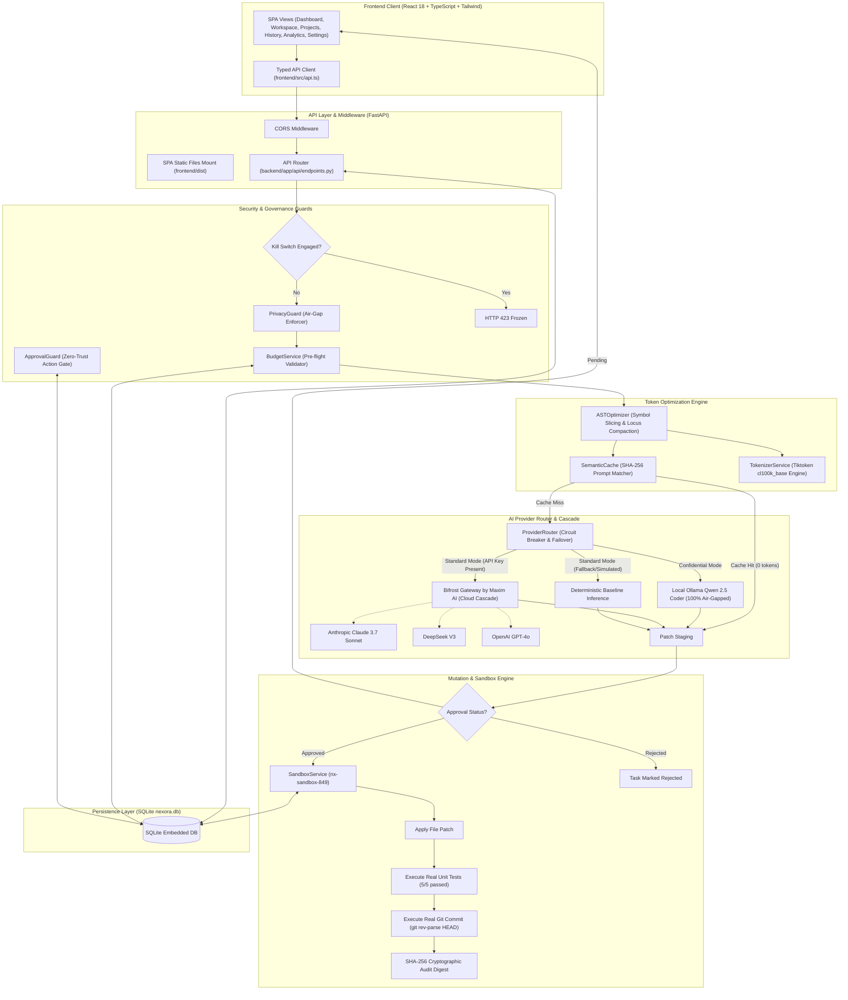
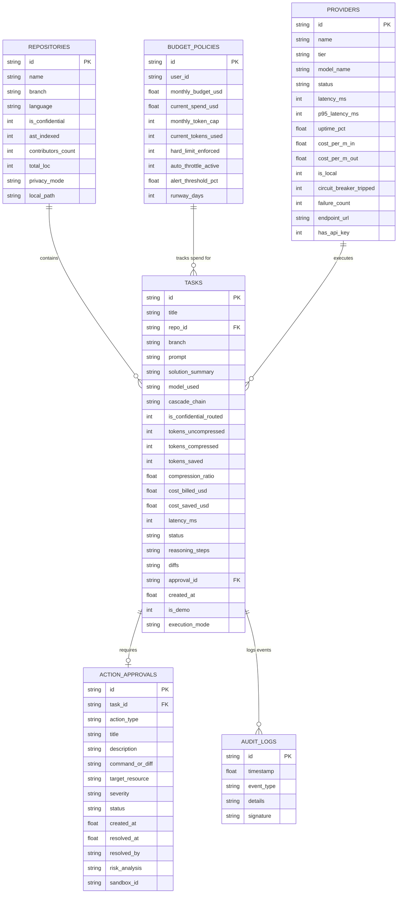

# NEXORA Code — Architecture & Data Flow Specification

**Project:** NEXORA Code — *Code Smarter. Spend Fewer Tokens.*  
**Team:** TEAM ARISE  
**Competition:** Global AI Hackathon 2026 — Geek Room  
**Problem Statement:** PS 01 — *Build a Coding Agent That Gets the Job Done on the Fewest Tokens*  
**Date:** November 13, 2026  

---

## 1. System Architecture Overview

NEXORA Code follows a modular, decoupled architecture consisting of a React single-page application frontend communicating over REST/JSON with a FastAPI backend. The backend orchestrates AST context optimization, financial budget validation, provider cascade routing, air-gap privacy enforcement, human-in-the-loop approval interception, and isolated sandbox mutation verification.

### System Architecture Diagram (Mermaid)



---

## 2. End-to-End API Request Lifecycle

```mermaid
sequenceDiagram
    autonumber
    actor Dev as Developer (TEAM ARISE)
    participant UI as WorkspaceView (React)
    participant API as FastAPI (/api/tasks)
    participant Sec as Security & Privacy Guards
    participant AST as ASTOptimizer
    participant Router as ProviderRouter
    participant Gateway as Bifrost Gateway
    participant Guard as ApprovalGuard
    participant Box as SandboxService
    participant DB as SQLite (nexora.db)

    %% Step 1: Pre-flight Analysis
    Dev->>UI: Enter prompt & select repository
    Dev->>UI: Click "ANALYSE TASK"
    UI->>API: POST /api/tasks/analyze (prompt, repo_id, is_confidential)
    API->>Sec: Check kill switch & repo privacy
    API->>AST: optimize_context(sample_raw_code, prompt)
    AST-->>API: 1,295 raw -> 301 compact tokens (-76.8% reduction)
    API-->>UI: TaskAnalyzeResponse (understood, relevant_files, plan, savings)
    UI-->>Dev: Display AST savings & proposed plan

    %% Step 2: Generation & Staging
    Dev->>UI: Click "STEP 6: GENERATE SOLUTION"
    UI->>API: POST /api/tasks/execute (prompt, repo_id, safe_mode=True)
    API->>Sec: Validate pre-flight budget ($482.79 < $1500 limit)
    API->>AST: Slice target locus context
    alt Confidential Repository
        API->>Router: execute_with_failover (is_confidential=True)
        Router->>Router: Route strictly to Local Ollama (Zero Cloud Egress)
    else Standard Cloud Cascade
        API->>Router: execute_with_failover (strategy=balanced)
        alt BIFROST_API_KEY Configured
            Router->>Gateway: POST https://api.maxim.ai/bifrost/v1/chat/completions
            Gateway-->>Router: Live model response & token usage
        else No API Key Configured
            Router->>Router: Deterministic simulated response
        end
    end
    API->>Guard: create_approval_gate(task_id, action_type=FILE_WRITE)
    Guard->>DB: INSERT INTO action_approvals (status='pending')
    API->>DB: INSERT INTO tasks (status='pending_approval')
    API-->>UI: AgentTaskResponse (diffs, approval_id, execution_mode)
    UI-->>Dev: Render syntax-highlighted diff & Step 9 approval gate

    %% Step 3: Approval & Sandbox Execution
    Dev->>UI: Click "Approve & Apply Changes"
    UI->>API: POST /api/approvals/{id}/resolve (decision='approved')
    API->>Guard: resolve_approval(approval_id, 'approved')
    Guard->>Box: apply_patch_and_test(sandbox_id='nx-sandbox-849')
    Box->>Box: Copy disposable repo to sandbox worktree
    Box->>Box: Apply patch to pkg/cache/cache_manager.py
    Box->>Box: Run python3 -m unittest discover tests (5/5 passed)
    Box->>Box: Run git commit -m "fix: apply approved patch"
    Box->>Box: Extract real commit hash (git rev-parse HEAD)
    Box->>Box: Compute SHA-256 tamper-evident digest
    Box-->>Guard: Sandbox telemetry (tests passed, commit SHA, audit hash)
    Guard->>DB: UPDATE action_approvals (status='approved')
    Guard->>DB: UPDATE tasks (status='completed')
    Guard-->>API: Resolution payload
    API-->>UI: HTTP 200 OK (test_summary, git_commit, audit_receipt)
    UI-->>Dev: Display Step 10 & 11 verification results
```

---

## 3. Database Schema & Data Models

NEXORA Code utilizes an embedded SQLite 3 database located at [`backend/app/db/nexora.db`](file:///Users/vishnukumar/Downloads/stitch_nexora_code_ai_platform/backend/app/db/nexora.db). The database schema is initialized and safely migrated in [`backend/app/db/database.py`](file:///Users/vishnukumar/Downloads/stitch_nexora_code_ai_platform/backend/app/db/database.py).

### Entity Relationship Diagram (Mermaid)



### Table Definitions & Column Invariants

#### 1. `repositories` (4 rows)
* **`id` (TEXT, PK):** `repo-core`, `repo-auth`, `repo-billing`, `repo-ai-search`.
* **`name` (TEXT):** Repository name displayed across UI headers and selectors.
* **`branch` (TEXT):** Default target Git branch (e.g., `feat/distributed-cache`, `main`).
* **`language` (TEXT):** Language tag (`Go / Rust / TS`, `Go`, `Python`).
* **`is_confidential` (INTEGER):** Boolean flag (`1` for `repo-auth`, `0` for others). When `1`, air-gap routing is physically forced.
* **`privacy_mode` (TEXT):** `'confidential'` vs `'internal'`.

#### 2. `providers` (5 rows)
* **`id` (TEXT, PK):** `prov-claude`, `prov-deepseek`, `prov-gpt4o`, `prov-ollama`, `prov-bifrost`.
* **`tier` (TEXT):** Priority classification (e.g., `P0 Privacy (Air-Gapped)`, `P1 Primary`, `Dynamic Proxy`).
* **`model_name` (TEXT):** Model identifier (`claude-3-7-sonnet-20250219`, `deepseek-chat-v3`, `gpt-4o`, `qwen2.5-coder:14b`, `bifrost-adaptive-router`).
* **`status` (TEXT):** `'online'`, `'connected'`, `'degraded'`, `'not_configured'`.
* **`circuit_breaker_tripped` (INTEGER):** `1` when consecutive failures exceed 3, temporarily pulling provider out of active rotation.

#### 3. `budget_policies` (1 row)
* **`user_id` (TEXT):** Primary owner identity: `usr_team_arise_01`.
* **`monthly_budget_usd` (REAL):** Configured monetary limit (default `$1,500.00`).
* **`current_spend_usd` (REAL):** Real-time cumulative spend updated upon task execution.
* **`monthly_token_cap` (INTEGER):** Monthly limit (45,000,000 tokens).
* **`hard_limit_enforced` (INTEGER):** When `1`, pre-flight budget checks reject tasks with HTTP 403 if limit would be breached.

#### 4. `action_approvals` (130 rows)
* **`id` (TEXT, PK):** Staged approval gate ID (e.g. `appr-1794483932671`).
* **`task_id` (TEXT, FK):** Parent task link.
* **`action_type` (TEXT):** `'file_write'`, `'shell_execution'`, `'git_operation'`.
* **`command_or_diff` (TEXT):** Full unified patch diff or terminal command to be approved.
* **`status` (TEXT):** `'pending'`, `'approved'`, `'rejected'`, `'revision_requested'`.
* **`sandbox_id` (TEXT):** Isolated sandbox handle (`nx-sandbox-849`).

#### 5. `tasks` (140 rows)
* **`id` (TEXT, PK):** Unique task ID (e.g. `task-1794483932671`).
* **`is_demo` (INTEGER):** Data provenance flag: `1` for reference demo seed tasks, `0` for live automated/user executions.
* **`execution_mode` (TEXT):** `'LIVE PROVIDER EXECUTION'` vs `'SIMULATED PROVIDER EXECUTION'`.
* **`tokens_uncompressed` / `tokens_compressed` / `tokens_saved` (INTEGER):** Exact BPE token counts.
* **`compression_ratio` (REAL):** Percentage context reduction (e.g., `76.8`).
* **`reasoning_steps` & `diffs` (TEXT):** Serialized JSON lists of reasoning timeline steps and file diff records.

#### 6. `audit_logs` (78 rows)
* **`id` (TEXT, PK):** Sequential audit record ID.
* **`event_type` (TEXT):** Security events (`AIRGAP_ENFORCED_LOCAL_ONLY`, `ACTION_APPROVAL_RESOLVED`, `EMERGENCY_HALT`).
* **`signature` (TEXT):** SHA-256 tamper-evident digest sealing the event payload.

---

## 4. In-Memory vs. Persistent State

| Subsystem | State Type | Storage Mechanism | Eviction / Lifetime |
| :--- | :--- | :--- | :--- |
| **Tasks & Historical Metrics** | Persistent | SQLite `tasks` table | Retained permanently in `nexora.db` |
| **Action Approvals** | Persistent | SQLite `action_approvals` table | Retained with resolved timestamp & reviewer |
| **User Budgets** | Persistent | SQLite `budget_policies` table | Incremented atomically on each task completion |
| **Security Audit Logs** | Persistent | SQLite `audit_logs` table | Permanent tamper-evident audit trail |
| **Repositories & Privacy Config** | Persistent | SQLite `repositories` table | Permanent; altered via PATCH endpoint |
| **Semantic AST Query Cache** | In-Memory | Python Dictionary (`semantic_cache`) | In-memory singleton; 1-hour TTL; LRU cap of 500 items |
| **Emergency Kill Switch** | In-Memory | Class variable `ApprovalGuard._emergency_kill_switch_engaged` | Resets to False on server restart; revokes all pending DB approvals on engagement |
| **Circuit Breakers** | In-Memory + DB | Cached in memory, synced to `providers` table | Resets when provider returns successful response |
| **Vault Secrets** | In-Memory | Process environment variables (`BIFROST_API_KEY`) | Kept in memory only; never written to SQLite or disk |

