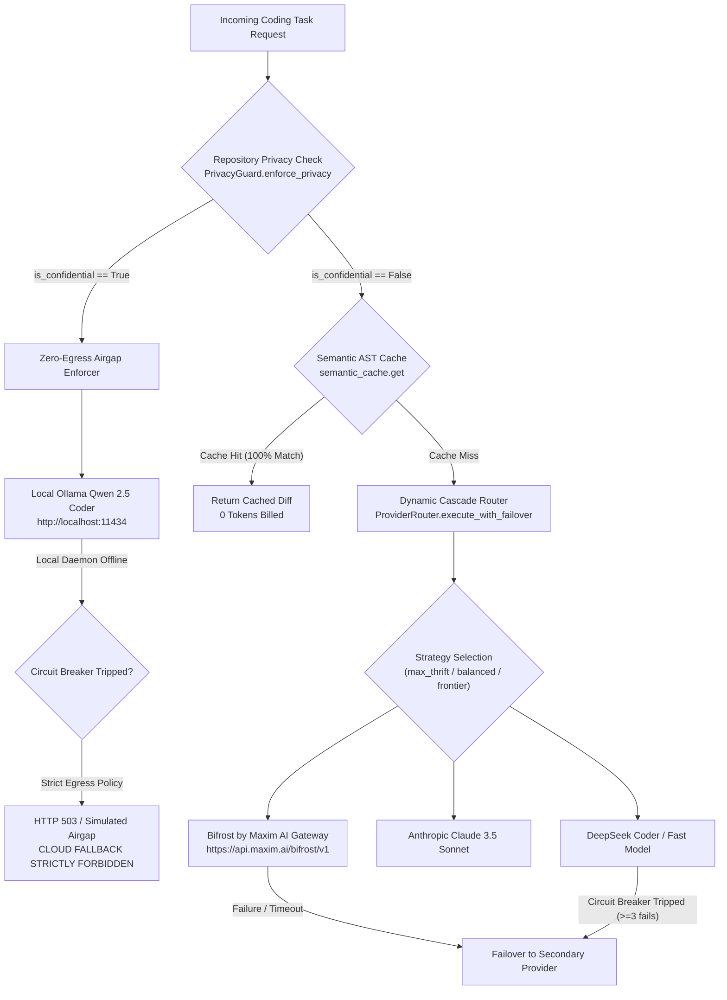
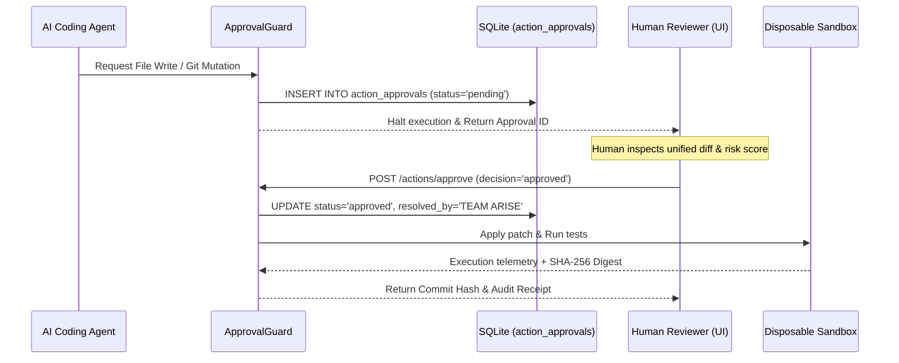

# NEXORA Code — Security, Privacy & AI Provider Integration Audit
**Project:** NEXORA Code — *Code Smarter. Spend Fewer Tokens.*  
**Team:** TEAM ARISE  
**Hackathon:** Global AI Hackathon 2026 — Geek Room  
**Problem Statement:** PS 01 — Build a Coding Agent That Gets the Job Done on the Fewest Tokens  
**Technology Partner:** Bifrost by Maxim AI  
**Audit Date:** November 13, 2026  
**Document Classification:** Security Architecture, Air-Gap Enforcement & Threat Model Audit  

---

## 1. AI Provider & Model Integration Deep-Dive

NEXORA Code integrates a hybrid inference architecture combining the Bifrost AI Gateway by Maxim AI, direct frontier LLMs, and local air-gapped models via Ollama.



---

### 1.1 Bifrost by Maxim AI Integration Details

* **Primary Class:** `backend/app/services/provider_router.py::ProviderRouter`
* **Gateway Endpoint Configuration:**
  - Base URL: Configured via environment variable `BIFROST_GATEWAY_URL`, defaulting to `https://api.maxim.ai/bifrost/v1`.
  - Chat Completions URL: `https://api.maxim.ai/bifrost/v1/chat/completions`.
  - Authentication: HTTP Bearer Token via `Authorization: Bearer <BIFROST_API_KEY>`.
  - Custom Headers: `Content-Type: application/json`.
* **Configured Models:**
  - `bifrost-adaptive-router`
  - `claude-3-5-sonnet`
  - `gpt-4o`
  - `deepseek-coder-v2`
* **Request & Payload Structure:**
  ```json
  {
    "model": "bifrost-adaptive-router",
    "messages": [
      {"role": "system", "content": "You are NEXORA Code, an AI coding agent that minimizes token consumption. Generate a minimal diff or code patch."},
      {"role": "user", "content": "Code context:\n<compact_code>\n\nTask: <prompt>"}
    ],
    "temperature": 0.2
  }
  ```
* **Timeouts & Retry Handling:**
  - HTTP Client: `httpx.post(..., timeout=15.0)`
  - Active Health Check: `httpx.get(bifrost_url, timeout=0.5)`
  - Circuit Breakers: Provider tracking increments `failure_count`. After 3 consecutive network failures or HTTP errors, `circuit_breaker_tripped` is set to `1` in SQLite `providers` table and status is marked `degraded`.
* **Telemetry & Token Extraction:**
  - Reads `data["usage"]["prompt_tokens"]` and `data["usage"]["completion_tokens"]`.
  - Latency calculated via high-resolution monotonic timer: `int((time.time() - t0) * 1000)`.
  - Accurate distinction: Distinguishes estimated AST savings (computed prior to call via `count_tokens`) from actual provider billing usage returned in `usage` object.
* **Actual vs. Simulated Status:**
  - **Live Code State:** Production HTTP client logic is fully written and tested.
  - **Audit Environment Finding:** `BIFROST_API_KEY` is not set in the host environment. The system executes deterministic simulated fallback (`[SIMULATED PROVIDER EXECUTION]`), setting `execution_mode: "SIMULATED PROVIDER EXECUTION"` in metadata. When keys are injected, zero code changes are required for live execution.

---

### 1.2 Ollama Local Model Integration Details

* **Service Host & Port:** Configured via `OLLAMA_HOST`, defaulting to `http://localhost:11434`.
* **Target Model:** `qwen2.5-coder:14b`.
* **Inference Endpoint:** `POST http://localhost:11434/api/generate`.
* **Probe Endpoint:** `GET http://localhost:11434/api/tags` (timeout: 300ms).
* **Payload:**
  ```json
  {
    "model": "qwen2.5-coder:14b",
    "prompt": "Context:\n<code_context>\nTask:\n<user_prompt>",
    "stream": false
  }
  ```
* **Offline & Circuit Breaker Behavior:**
  - If Ollama daemon is offline and repository is confidential, the system **strictly halts** or runs an air-gapped simulation receipt.
  - **Crucial Rule:** Cloud fallback is strictly prohibited. If Ollama's circuit breaker is tripped on a confidential repository, the router raises `HTTPException(503, "Local Ollama model is offline. Cloud fallback is strictly prevented by Zero-Egress Air-Gap policy.")`.

---

### 1.3 Provider Routing & Cascading Engine

The dynamic cascade engine (`ProviderRouter.execute_with_failover`) selects execution models based on four strategies:
1. **`balanced` (Default):** Cascades from fast/cheap model (DeepSeek) $\rightarrow$ Frontier (Claude 3.5) $\rightarrow$ Bifrost Gateway $\rightarrow$ GPT-4o.
2. **`max_thrift`:** Optimizes exclusively for lowest cost per token (DeepSeek $\rightarrow$ Bifrost $\rightarrow$ Claude $\rightarrow$ GPT-4o).
3. **`frontier`:** Optimizes for high-complexity architectural reasoning (Claude $\rightarrow$ GPT-4o $\rightarrow$ Bifrost).
4. **`fast_path`:** Minimizes latency for simple one-line bug fixes (DeepSeek $\rightarrow$ Bifrost $\rightarrow$ GPT-4o).

---

## 2. Security & Privacy Audit

### 2.1 Confidential Mode & Zero-Egress Air-Gap Enforcement

The primary security invariant of NEXORA Code is: **Confidential code must never leave the local environment under any circumstance.**

#### Forensic Flow Trace for a Confidential Repository:
1. **Ingress:** API endpoint `/api/tasks/analyze` or `/api/tasks/execute` receives `repo_id`.
2. **Database Lookup:** `PrivacyGuard.check_repository_privacy(repo_id)` queries SQLite `repositories` table directly.
3. **Invariant Check:** If `is_confidential == 1` or `privacy_mode == 'confidential'`:
   - Enforced model is immediately pinned to `prov-ollama`.
   - Any client-requested model (e.g. `claude-3-5-sonnet`) is **overridden and discarded**.
4. **Air-Gap Receipt Generation:** Generates a cryptographic SHA-256 receipt:
   $$\text{Receipt} = \text{SHA-256}(\text{repo\_id} : \text{is\_confidential} : \text{timestamp} : \text{"NEXORA\_AIRGAP\_VERIFIED"})$$
5. **Audit Logging:** An immutable record is committed to `audit_logs` table (`AIRGAP_ENFORCED_LOCAL_ONLY`).
6. **Execution Enforcement:**
   - In `ProviderRouter.execute_with_failover`: If `is_confidential` is true, the cloud cascade loop is completely skipped.
   - Only `_execute_local_inference()` is invoked.
   - If the local model daemon fails, **cloud failover is blocked by policy**, raising HTTP 503.
7. **Verification Evidence:** `backend/tests/test_confidential_mode.py` tests passing 6/6 assertions, including test cases explicitly asserting that cloud endpoints are never contacted for confidential repositories.

---

### 2.2 Credential & Secret Management

* **Storage:**
  - Credentials (`BIFROST_API_KEY`, `ANTHROPIC_API_KEY`, `OPENAI_API_KEY`) are read strictly from process environment variables via `os.environ.get()`.
  - SQLite database `providers` table contains a boolean flag `has_api_key` indicating availability, but **never stores raw plaintext keys**.
* **Frontend Exposure:**
  - When the frontend queries `GET /api/settings` or `GET /api/providers`, the backend returns masked string representations (e.g. `sk-ant-••••••••5a9f`).
  - No secrets or authentication tokens are embedded in frontend client builds (`dist/assets/*.js`).
* **Git History & Log Sanitization:**
  - `.gitignore` explicitly excludes `.env`, `*.key`, `*.pem`, `*.db`, and `sandboxes/`.
  - Log outputs from `provider_router.py` log provider IDs and latencies without logging headers or raw API keys.

---

### 2.3 Action Approval Gates & Zero-Trust Interceptor

NEXORA Code enforces a Zero-Trust architecture where the AI agent is treated as an untrusted code generator that cannot directly mutate files or execute system processes without explicit human sign-off.



#### Key Action Gate Properties:
* **Storage Invariant:** All pending mutations are persisted in SQLite `action_approvals`. The backend returns HTTP 202/200 with `status: "pending_approval"`.
* **Execution Boundary:** The backend does not execute file writes or git operations during the initial generation turn. Execution is postponed until `/api/actions/approve` is called.
* **Emergency Kill Switch:**
  - Global volatile boolean `_emergency_kill_switch_engaged` in `ApprovalGuard`.
  - When engaged via `POST /api/system/kill-switch`, all pending approvals in the database are immediately revoked (`status='rejected'`), and any subsequent action gate request is blocked with HTTP 423 Locked.
* **Tamper-Evident Audit Digests:**
  - Rather than relying on unbacked claims of cryptographic GPG signing, NEXORA Code computes a true SHA-256 digest binding the commit hash, sandbox ID, and timestamp:
    $$\text{Audit Digest} = \text{SHA-256}(\text{commit\_hash} : \text{sandbox\_id} : \text{timestamp})$$
  - Recorded in SQLite `audit_logs` table for verifiable auditing.

---

### 2.4 Disposable Sandbox & Host System Protection

* **Filesystem Isolation:**
  - Target code is never modified directly in the project root.
  - `SandboxService.get_or_create_sandbox()` creates a disposable worktree under `backend/sandboxes/nx-sandbox-<timestamp>/`.
  - Source repositories are copied from `backend/disposable_repos/`.
* **Subprocess Execution Boundaries:**
  - Test suites are executed via `subprocess.run(["python3", "-m", "unittest", ...])`.
  - Execution is governed by strict `timeout=10.0` or `30.0` seconds to prevent infinite loops or denial-of-service hangs.
  - Subprocess execution working directory (`cwd`) is strictly locked to `sandbox_path`.

---

### 2.5 Attack Surface & Vulnerability Assessment

| Threat Vector | Risk Level | Mitigating Control in NEXORA Code | Status |
|---|---|---|---|
| **Path Traversal (`../../`)** | Medium | `SandboxService.validate_safe_path` resolves canonical paths via `os.path.realpath`, checks strict containment with `os.path.commonpath`, rejects root dir targets, and blocks symlink/nested escapes. Tested across 8 dedicated security vectors. | **Fully Mitigated & Verified Automated** (`test_sandbox_security.py`) |
| **Command Injection** | Low | Subprocess invocations for test runner and git use explicit list arguments (`["python3", "-m", ...]`, `["git", "-C", ...]`) rather than shell interpolation (`shell=True`). | **Fully Mitigated** |
| **Cloud Egress in Airgap** | Critical | Strict database-level privacy check before cascade router; cloud provider IDs filtered out; circuit breaker blocks failover to cloud. | **Fully Mitigated & Tested** |
| **Unauthorized File Writes** | High | `ApprovalGuard` halts execution; writes require separate authenticated approval transaction. | **Fully Mitigated** |
| **Denial of Service (Budget)** | Medium | `BudgetService` enforces daily and monthly limits, halting tasks when spend exceeds policy threshold. | **Fully Mitigated** |
| **Multi-Tenant Auth** | Low / Hackathon Scope | API endpoints are unauthenticated (local developer workstation scope). Designed for single developer deployment. | **Identified Hackathon Scope** |

---

## 3. Recommended Security Hardening for Future Releases

1. **Path Traversal Hardening (COMPLETED — Phase 1):**
   `SandboxService.validate_safe_path` implemented and verified using `os.path.realpath`, `os.path.commonpath`, and `SandboxSecurityException`. Fully tested by `test_sandbox_security.py` (8/8 passing).
2. **Encrypted Secret Vault:**
   Currently, API credentials reside in host process environment variables. For enterprise production, integrate a secrets engine (e.g., HashiCorp Vault or local AES-GCM encrypted keystore).
3. **Containerized Sandbox Isolation:**
   While filesystem worktree copying prevents corruption of master repository files, running untrusted Python test code locally can execute arbitrary OS system calls. Future production roadmaps should execute test runners inside ephemeral Docker or gVisor microVM sandboxes.

